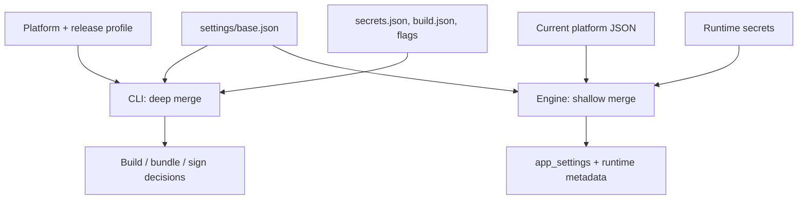
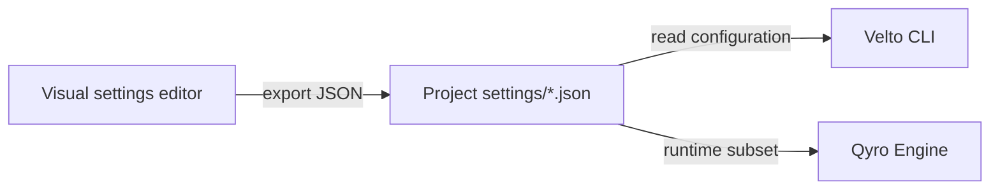

Velto applications have two different configuration consumers: **Velto CLI** prepares, freezes, and distributes applications; **Qyro Engine** reads application settings when they execute. The same JSON may be visible to both consumers, but a field only changes behavior when that consumer actually implements it.

The scaffold created by `velto init` already includes configuration. The examples on this page illustrate fields and semantics: **you should edit generated files, not manually recreate the project**. See [Project structure](/getting-started/project-structure) and [Create and run](/cli/create-and-run).

## Configuration ownership

| File | Read by | Responsibility |
| --- | --- | --- |
| `settings/base.json` | CLI + Engine | Application identity, framework, entry point, window settings, shared values |
| `settings/windows.json`, `mac.json`, `linux.json` | CLI + Engine | Operating-system overrides; build flags and runtime settings can coexist |
| `settings/release.json` | CLI | Release build profile, resource protection, installer presentation, extra files |
| `build.json` (project root) | `velto build` | Build manifest overrides; not a runtime settings file |
| `settings/secrets.json` | CLI encryption pipeline + Engine | Runtime application secrets; **never** signing credentials |
| `settings/sign.json` | `velto sign` | Windows certificates, macOS signing identity and notarization credentials; never packaged |

### What happens when configuration is loaded?



**CLI precedence for a normal build (low → high):** `base.json` → host platform → selected profile (normally `release.json`) → `secrets.json` → recognized keys in `build.json` → explicit command flags. The CLI recursively merges objects; scalar and array values are replaced while profiles are loaded. **Exceptions:** the build manifest concatenates `hidden_imports`, `paths`, `collect_all`, and `extra_args` with settings, deduplicating hidden imports.

**Engine precedence (low → high):** `base.json` → first valid host platform JSON → plaintext `secrets.json` → encrypted secrets, when available. Engine uses `dict.update()`, so each top-level value replaces its predecessor **entirely**. It does not activate `release.json`, `sign.json`, or `build.json`.

For example, putting `"window": {"width": 1200}` in a platform file **replaces** the entire `window` object at runtime. Since `VeltoContext` expects both positive integer dimensions, omitting `height` makes it fall back to 800 × 600. Specify **both dimensions** in platform overrides.

<Warning>Bad JSON or a non-object top-level value may be silently ignored by a loader. Validate generated and edited settings before releasing. The two consumers do not enforce identical merge rules.</Warning>

## `settings/base.json` — project and runtime identity

This is an **actual example uploaded from a Velto project** (not a required template):

```json
{
  "app_name": "demo",
  "author": "fredo",
  "entry_point": "main.py",
  "addons": [],
  "version": "1.0.0",
  "framework": "PySide6",
  "hidden_imports": [
    "__future__"
  ],
  "window": {
    "width": 800,
    "height": 600
  },
  "optimization": {
    "exclude_modules": [
      "tkinter",
      "unittest",
      "test",
      "pydoc"
    ]
  }
}
```

| Field | Type | What it controls | Notes |
| --- | --- | --- | --- |
| `app_name` | non-empty string | Application/window name; executable and packaging name | Build falls back to project directory |
| `author` | string | Publisher metadata | Build default `Developer` |
| `version` | string | Runtime metadata and package version | Default `1.0.0`; use semantic versions |
| `entry_point` | relative path | Script run by `velto start` and frozen by build | `start` requires the actual file; build defaults to `main.py` |
| `framework` | string | Renderer choice and framework-specific freezer hooks | PySide6, PyQt6, PyQt5, PySide2, Kivy, Tkinter; `binding` is an Engine legacy fallback |
| `window.width`, `window.height` | positive integers | Native window size and Velto layout viewport | Engine defaults to 800 × 600 if block or either dimension invalid |
| `icon` | path | Icon used by PyInstaller and, when resolvable, application window | `app_icon` is a runtime alias, **not** build alias |
| `hidden_imports` | string array | Modules omitted by static import discovery | Use for dynamic imports; not for arbitrary dependencies |
| `addons` | array | Project/template metadata | Does not automatically enable freezer hooks |
| `identifier`, `description` | strings | Runtime metadata | `mac_bundle_identifier` is separate build metadata |
| `freeze_dir` | path | Paths expected by some clean/bundle/sign workflows | Freezer currently writes to `build`; avoid customizing this |
| Other application keys | JSON values | Available via `app_settings` | Not automatically interpreted by CLI |

`framework` and `window` are significant **runtime** features, not merely packaging metadata. For the runtime-facing explanation, see [Runtime settings and configuration](/runtime/settings-and-configuration).

## Platform profiles — settings and packaging differ by OS

The generated `windows.json`, `mac.json`, and `linux.json` are overrides, not independent complete applications. The JSON below represents the **supplied project configurations**. Some fields are intentionally absent because the CLI supplies defaults.

### Windows: `settings/windows.json`

```json
{
  "bundle_mode": "onedir",
  "uac": {
    "level": "asInvoker",
    "ui_access": false
  },
  "debug": {
    "enabled": false,
    "console_window": false
  },
  "optimization": {
    "strip_binaries": false,
    "clean_build": false,
    "upx_enabled": false,
    "upx_level": 1,
    "upx_excludes": [
      "vcruntime140.dll",
      "python3*.dll",
      "PySide6.QtCore.pyd"
    ],
    "bytecode_opt": 0,
    "exclude_modules": [
      "unittest",
      "test",
      "pydoc"
    ]
  }
}
```

| Setting | Effect |
| --- | --- |
| `bundle_mode` | `onedir` (directory) or `onefile` (single executable); `bundle` and `single` are accepted aliases |
| `uac.level` | `asInvoker` (standard privileges) or `requireAdministrator` (elevation); `highestAvailable` is parsed but does not currently emit a dedicated freezer switch |
| `uac.ui_access` | Requests `--uac-uiaccess`; requires careful signing and installation configuration |
| `debug.enabled` | Enables build diagnostic mode and console output |
| `debug.console_window` | Alias for `debug.console` |
| `optimization.upx_excludes` | Protects matching runtime/Qt binaries from UPX compression |

`uac` modifies the **frozen executable's manifest**; it does not configure the NSIS installer's own `bundle.nsis.execution_level`. `velto build --uac` forces administrator mode for that invocation.

### Linux: `settings/linux.json`

```json
{
  "categories": "Utility;",
  "description": "",
  "author_email": "",
  "url": "",
  "bundle_mode": "onedir",
  "debug": {
    "enabled": false,
    "console": false
  },
  "optimization": {
    "strip_binaries": false,
    "clean_build": false,
    "upx_enabled": false,
    "upx_level": 1,
    "bytecode_opt": 0,
    "upx_excludes": [
      "libpython3*.so*",
      "QtCore.abi3.so"
    ],
    "exclude_modules": [
      "tkinter",
      "unittest",
      "test",
      "pydoc"
    ]
  }
}
```

| Field | Meaning |
| --- | --- |
| `categories` | Desktop-category metadata; current FPM packaging adapter does not propagate it automatically |
| `description`, `author_email`, `url` | Application/distribution metadata; not all current Linux package flows consume them |
| `optimization.upx_excludes` | Linux-specific binary patterns, e.g. `libpython` or Qt libraries |

Linux `.deb`, `.rpm`, and Arch packaging primarily uses `app_name`, `version`, and the target installation layout. Do not assume `categories`, `url`, or `description` become package metadata without verifying the resulting package.

### macOS: `settings/mac.json`

```json
{
  "bundle_mode": "onedir",
  "bundle_identifier": "None",
  "debug": {
    "enabled": false,
    "console": false
  },
  "optimization": {
    "strip_binaries": false,
    "clean_build": false,
    "upx_enabled": false,
    "bytecode_opt": 1,
    "exclude_modules": [
      "unittest",
      "test",
      "pydoc"
    ]
  }
}
```

| Field | Meaning |
| --- | --- |
| `mac_bundle_identifier` | Reverse-DNS bundle identifier passed to PyInstaller; `bundle_identifier` is an accepted alias |
| `mac_target_architecture` | Target architecture; a `universal2` build requires universal dependencies |
| `optimization.upx_enabled` | UPX is disabled on macOS regardless of JSON value |

If `bundle_identifier` is literally the string `"None"` (as in the supplied sample), **do not assume it is equivalent to JSON `null`**. Replace it with a real reverse-DNS identifier for a production `.app`.

### Common build-only keys available in platform files

| Field | Value or default | Behavior |
| --- | --- | --- |
| `paths` | `[]` | Additional module/binary lookup paths, passed as `--paths` |
| `collect_all` | `[]` | Packages whose metadata, data and binaries must be collected; can increase output size |
| `hidden_imports` | `[]` | Extra dynamic imports |
| `extra_args` | `[]` | Additional raw PyInstaller arguments; `extra_pyinstaller_args` is an alias |
| `debug.enabled` | `false` | Build debugging and console |
| `debug.console` / `console_window` | `false` | Console visibility |
| `debug.unstripped` | `false` | Import debugging, **not** equivalent to disabling binary stripping |
| `debug.bootloader_debug` | `false` | Verbose bootloader tracing; takes priority over import debugging |

### Optimization — complete field reference

```json
{
  "optimization": {
    "strip_binaries": false,
    "clean_build": false,
    "upx_enabled": false,
    "upx_dir": null,
    "upx_level": 1,
    "upx_excludes": [],
    "bytecode_opt": 1,
    "exclude_modules": [],
    "exclude_binaries": [],
    "exclude_plugins": [],
    "remove_translations": false
  }
}
```

This is a **conservative example**, not an instruction to set all values. Omitted fields receive loader defaults, which may differ from the generated profiles.

| Field | Recognized behavior |
| --- | --- |
| `strip_binaries` | Strip compatible Unix binaries; skipped on Windows |
| `clean_build` | Clean PyInstaller state and post-build temporary/runtime artifacts |
| `upx_enabled` | Enable UPX compression where supported; disabled on macOS |
| `upx_dir`, `upx_level` | UPX executable location and post-build compression level (1–9) |
| `upx_excludes` | Glob patterns exempting critical binaries from compression |
| `bytecode_opt` | `0` (none), `1` (`-O`), `2` (`-OO`, removes docstrings) |
| `exclude_modules` | Modules excluded at freeze time, with related output pruning |
| `exclude_binaries` | Output binary glob patterns removed after freezing |
| `exclude_plugins` | Qt plugin directories/categories removed after freezing |
| `remove_translations` | Delete translation directories in output |

<Warning>Post-build exclusion can silently break a successful freeze. Removing `QtNetwork`, `tls`, `imageformats`, `styles`, `QtWebEngine`, QML, multimedia, OpenGL, or Qt platform plugins can disable real application features. Begin without exclusions and test each change on a clean machine.</Warning>

The required Qt platform plugin varies by OS (`qwindows`, `qcocoa`, `qxcb`). In general, only exclude Qt plugin families after confirming your app does not use them. See [Build and freeze](/cli/build-and-freeze).

## `settings/release.json` — protection and installers

The supplied release profile is:

```json
{
  "bundle": {
    "dmg": {
      "window": {
        "x": 200,
        "y": 120
      },
      "window_size": {
        "width": 660,
        "height": 420
      },
      "icon_size": 100,
      "app_position": {
        "x": 160,
        "y": 200
      },
      "applications_position": {
        "x": 510,
        "y": 200
      },
      "background": "resources/mac/release/dmg-background.png",
      "extra_files": []
    },
    "extra_files": [],
    "nsis": {
      "icons": {
        "install": "resources/base/icons/install.ico",
        "uninstall": "resources/base/icons/uninstall.ico"
      },
      "welcome_bitmap": "",
      "install_location": "programfiles64",
      "execution_level": "highest"
    }
  }
}
```

Its `bundle` object configures the **distribution packaging layer**, not the runtime window or its UI. In particular, `bundle.dmg.window` and `window_size` describe the *DMG Finder presentation*, whereas `base.json`'s `window` configures the running application.

| Field | Meaning |
| --- | --- |
| `bundle_mode` | Optional build/profile override, e.g. `onedir` |
| `resource_protection.enabled` | Enable encrypted packaging of application settings and resources (default `false`) |
| `resource_protection.settings_dir` | Source settings folder (default `settings`) |
| `resource_protection.resources_dir` | Source resources folder (default `resources`) |
| `resource_protection.bundle_path` | Protected archive location (default `.velto/resources.pak`) |
| `bundle.extra_files` | Additional files at release root; string path or `{source, destination}` |
| `bundle.dmg.window` | DMG window position `{x, y}` |
| `bundle.dmg.window_size` | DMG window dimensions `{width, height}` |
| `bundle.dmg.icon_size` | DMG icon size (positive integer) |
| `bundle.dmg.app_position` | Position of the app icon; alias `app_icon_position` |
| `bundle.dmg.applications_position` | Position of Applications shortcut; alias `app_drop_link` |
| `bundle.dmg.background` | DMG background asset path; verify it exists |
| `bundle.dmg.extra_files` | Extra files **inside** DMG staging, unlike generic release-root files |
| `bundle.nsis.icons.install` / `uninstall` | Installer/uninstaller `.ico` files |
| `bundle.nsis.welcome_bitmap` | Optional installer bitmap |
| `bundle.nsis.install_location` | `programfiles64` (default), `programfiles32`, `appdata` |
| `bundle.nsis.execution_level` | `highest` (default), `admin`, `user`; independent from executable UAC |

`bundle.dmg.extra_files` requires the `create-dmg` flow; generic `bundle.extra_files` belongs to release-root layouts and does not automatically insert files into DMG. `velto bundle --check` checks release prerequisites and paths. Resource protection has its own guide: [Protected resources](/cli/protected-resources).

<Note>`release_dir`, installer format, copying resources, and ZIP creation are **CLI flags**, not `release.json` defaults. Select these with `velto bundle --release-dir`, `--format`, `--no-resources`, and `--zip`.</Note>

## Project-root `build.json` — explicit freezing overrides

`build.json` is optional and is **not** inside `settings/`. It can override recognized scalar manifest properties such as `app_name`, `author`, `version`, `entry_point`, `framework`, `platform`, `bundle_mode`, `icon`, `uac`, `debug`, `optimization`, `mac_bundle_identifier`, and `resource_protection` (also recognized as `protected_resources`). It can also supply `hidden_imports`, `paths`, `collect_all`, and `extra_args`.

```json
{
  "entry_point": "src/main.py",
  "bundle_mode": "onefile",
  "hidden_imports": ["my_app.plugins.reports"],
  "collect_all": ["babel"],
  "paths": ["vendor"],
  "extra_args": ["--log-level", "WARN"]
}
```

The supported lists are appended to matching settings lists rather than simply replacing them; only `hidden_imports` are deduplicated. `platform` selects a target manifest and **does not mean cross-compilation**: generate Windows/macOS/Linux artifacts on their corresponding hosts.

## `settings/sign.json` — local signing credentials

Unlike `secrets.json`, signing credentials are **not needed by the running app** and must never be embedded in the distributed application.

```json
{
  "sign": {
    "windows": {
      "certificate": "src/sign/windows/certificate.pfx",
      "password": "REPLACE_LOCALLY",
      "timestamp_server": "https://timestamp.digicert.com",
      "description": "My App",
      "url": "https://example.com"
    },
    "mac": {
      "identity": "Developer ID Application: Example (TEAMID)",
      "entitlements": "src/sign/mac/entitlements.plist",
      "notary": {
        "enabled": true,
        "staple": true,
        "assess_gatekeeper": true,
        "keychain_profile": "APP-NOTARY"
      }
    }
  }
}
```

| Field | Description |
| --- | --- |
| `sign.windows.certificate` | PFX/P12 file used by `signtool`; should remain local/CI-secret-injected |
| `sign.windows.password` | Certificate password; **not** a runtime application secret |
| `sign.windows.timestamp_server` | Trusted timestamp endpoint (optional) |
| `sign.windows.description`, `url` | Signature metadata |
| `sign.mac.identity` | Keychain Developer ID identity |
| `sign.mac.entitlements` | Entitlements plist |
| `sign.mac.notary.enabled`, `staple`, `assess_gatekeeper` | Notarization, stapling, and assessment options |
| `sign.mac.notary.keychain_profile` | Stored `notarytool` credential profile |
| `sign.mac.notary.key_path`, `key_id`, `issuer` | API-key notarization credentials |
| `sign.mac.notary.apple_id`, `team_id`, `app_password` | Apple ID notarization credentials |

Keep `settings/sign.json`, certificate files and keys out of version control. `velto sign` loads it after release settings; the Engine does not load it and the build excludes it from ordinary and protected resource packages. See [Bundle and sign](/cli/bundle-and-sign).

## `settings/secrets.json` — runtime-sensitive values

This is a **flat application settings override** (not a signing profile):

```json
{
  "api_url": "https://api.example.com",
  "service_token": "REPLACE_LOCALLY"
}
```

Runtime encryption and loading are covered in [Secrets and protection](/cli/secrets-and-protection). The Engine combines values superficially, so prefer flat secret keys or repeat complete nested objects when replacing them. Never include `sign` or legacy signing keys in runtime secrets: the CLI rejects them.

## Using the Settings Builder

The [Qyro Settings Builder](https://qyro-settings-builder.up.railway.app/) is a **visual configuration editor** for application, platform, resource and release settings. The `Velto-CLI/release` README also names a Velto-branded builder endpoint; the Qyro URL here is the one supplied for this documentation. Both should be treated as auxiliary editors, **not as sources of truth for accepted keys**.

A useful mental model is:



The exported files remain ordinary project JSON. Review their values, compare them with the generated boilerplate and inspect paths to icons/backgrounds before building. **Do not provide passwords, API tokens, private keys, `secrets.json`, or `sign.json` to a web editor.** Prepare those files locally or through a trusted CI secret store.

<Note>The editor's live interface could not be inspected from this environment. Its general purpose and export workflow are supported by the repository READMEs, but its exact controls, current form fields and export validation have **not** been independently verified. Treat this page and the current `release` implementation as the configuration contract.</Note>

## How to verify configuration decisions

`velto start` validates entry point and framework using the existing project. `velto bundle --check` and `velto sign --check` are preflight checks for distribution and signing respectively; they do not validate all possible runtime settings. Test the **actual frozen artifact**, including every feature affected by binary/module exclusions.

For renderer setup and window dimensions, see [Runtime settings](/runtime/settings-and-configuration). For runtime file lookup, see [Resources and environment](/runtime/resources-and-environment). For build artifact management, see [Build and freeze](/cli/build-and-freeze).
