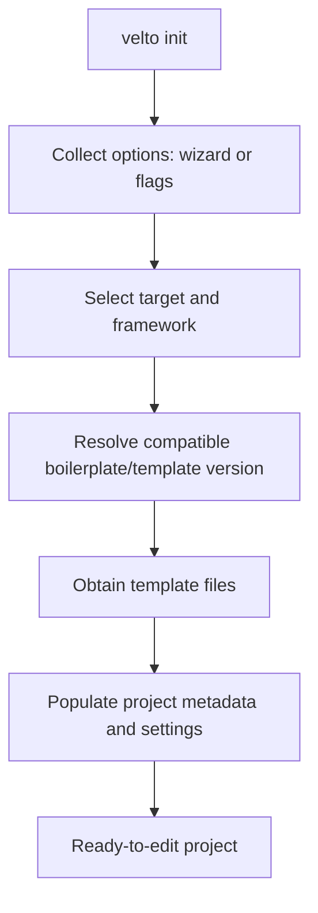

`velto init` is a **project generator**, not a command that creates an empty directory for you to populate. It resolves a boilerplate for the selected target and GUI framework, obtains the template, and configures the generated project with your answers. You should normally **edit the generated application**, not recreate its entry point, settings, and folders by hand.

## What initialization does



The interactive wizard and command-line flags provide inputs to the **same initialization workflow**. A fully specified invocation is useful for automation; it is not a second kind of project.

```bash
velto init --name my-velto-app
```

This opens the interactive flow for information not supplied. The equivalent non-interactive intention can be expressed with:

```bash
velto init \
  --name my-velto-app \
  --target-platform desktop \
  --framework PySide6 \
  --app-name "My Velto App" \
  --version 1.0.0 \
  --author "Your Name" \
  --yes
```

`--yes` skips the final confirmation using the supplied/default values. It does **not** change the role of the boilerplate. The generator remains responsible for creating and populating the project.

## Initialization options and their meaning

| Option | Meaning |
| --- | --- |
| `-n, --name` | Destination project directory; defaults to `.` |
| `-f, --framework` | GUI framework/template choice: PySide6, PyQt6, PyQt5, PySide2, Kivy, or Tkinter |
| `--target-platform` | Template target: `desktop`, `x86_64`, `apple-silicon`, `iphone`, `android` |
| `--template-version` | Select a specific available template version |
| `--app-name` | Human-readable application name written into generated settings |
| `--version` | Initial application version |
| `--author` | Initial author metadata |
| `--addon` | Repeatable optional add-on: `hotrl`, `pydux`, `sentry-sdk`, `requests` |
| `--bundle-id` | Bundle identifier for applicable Apple targets |
| `-y, --yes` | Skip confirmation |

**Target versus framework:** the target selects the kind of project to scaffold; the framework selects the GUI technology. They are not synonyms. Mobile target choices are experimental even though the parser accepts them.

## What belongs to the generated project

The selected boilerplate supplies its entry point, dependency declarations, settings and resource layout. Initialization fills in project-specific values. The exact generated files depend on the template and version; avoid assuming that every boilerplate has an identical tree. See [Project structure](/getting-started/project-structure) for the generated layout and [Configuration files](/cli/configuration-files) for the meaning of its JSON settings.

The GUI framework is a real dependency: selecting `PySide6` does not make an unrelated Python environment capable of importing PySide6. Use the environment and dependencies expected by the generated project.

## What `velto start` does

Once initialized, `velto start` runs the **existing project from source**:

```bash
cd my-velto-app
velto start
```

It delegates execution to the CLI's application-run use case. Unlike `init`, it does not ask you to select a new template or rewrite the application. Source execution uses the project's configuration and installed Python packages; it is not the same as launching a frozen release. See [Runtime settings](/runtime/settings-and-configuration) and [Resources and environment](/runtime/resources-and-environment).

The current `start` command exposes **no additional command-specific flags**. To inspect the actual installed version, use `velto start --help`.

## When to use each operation

Use `init` when **creating a new project** or deliberately generating a separate scaffold. Use `start` while **developing or testing that project**. Use `build` when you need a distributable frozen artifact. Changing application code after initialization does not require running `init` again.

If source startup fails, inspect the generated entry point, environment and settings **as generated**, rather than replacing them with a generic example. See [CLI troubleshooting](/cli/troubleshooting).
