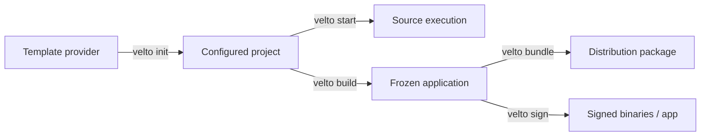

Velto CLI is the **project and distribution tool** for Velto applications. It is not the UI renderer: PSX Markup describes interfaces, while the runtime starts the application and resolves configuration and resources. The CLI coordinates the work around that application—from obtaining a project template to producing an installable artifact.

## The lifecycle of a project

These operations solve different problems. **Initialization** generates project files from a boilerplate and fills in the supplied metadata. **Starting** executes the existing project; it does not regenerate it. **Building** freezes Python code and dependencies into desktop artifacts. **Bundling** packages those artifacts for delivery. **Signing** establishes publisher identity where supported; it does not encrypt your source code.

## Command responsibilities

| Command | Consumes | Result |
| --- | --- | --- |
| `velto init` | Template selection and project metadata | Scaffolded project with configured files |
| `velto start` | Existing project and Python environment | Application running from source |
| `velto build` (`freeze`) | Project, settings, installed dependencies | Frozen desktop artifacts |
| `velto bundle` (`installer`) | Frozen artifacts and release settings | DMG, NSIS, Linux package, archive, or directory |
| `velto sign` | Frozen artifacts and local signing configuration | Signed output, optionally notarized on macOS |
| `velto clean` | Generated build outputs | Removed build files; `--release` also removes release outputs |
| `velto version` | Installed CLI | CLI version information |

Commands operate on the **project you are working in** after initialization. `velto init --name` is different: it chooses the destination project directory.

## Supported scope

The supported workflow is desktop on Windows, macOS, and Linux. PySide6, PyQt6, PyQt5, PySide2, Tkinter, and Kivy are template/framework choices, but successful build coverage differs by framework and Python version. Mobile-related targets and extras are experimental; their presence in command options does not imply production support.

Install the desktop toolchain with `pip install "velto-cli[desktop]"`. The CLI is not a replacement for your application's framework and dependencies. The installed console command is **`velto`**; this is verified in the `release` branch's `pyproject.toml`.

To prepare and edit JSON without hand-writing every option, see [Configuration files](/cli/configuration-files) and the [Qyro Settings Builder](https://qyro-settings-builder.up.railway.app/). The visual editor prepares ordinary nonsecret JSON; the build and runtime implementations remain the authoritative validators.

For the first application, use [Getting started](/getting-started/overview). For the structure created by the generator, see [Project structure](/getting-started/project-structure). The following pages describe CLI behavior and contracts rather than repeating those tutorials.
