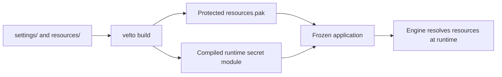

Protected resources address a distribution problem: a desktop application often needs configuration and files **after** its Python source has been frozen. Shipping them as loose plaintext files makes casual extraction or modification straightforward. Velto can package project `settings/` and `resources/` into an encrypted archive that the runtime knows how to resolve.

This is different from **secrets encryption**: `secrets.json` receives dedicated protection even when full resource protection is disabled. See [Secrets and protection](/cli/secrets-and-protection).

## Build-time and runtime responsibilities



When resource protection is enabled, the build creates a fresh secret, compiles a native runtime module with Cython, wraps the resource key, and embeds the package plus module into the frozen application. The Engine extracts authenticated protected package contents to a temporary directory, ignores non-settings/resources paths, skips extracting encrypted secrets as ordinary files, and resolves resources using its usual public resource API. The protected package uses a SHA-256-derived XOR stream **with HMAC-SHA256 integrity**; do not confuse that mechanism with the separate AES-256-GCM encryption used for `secrets.json`.

## Configuration contract

The release profile supports (all four keys are explained in the [Configuration files reference](/cli/configuration-files)):

```json
{
  "resource_protection": {
    "enabled": true,
    "settings_dir": "settings",
    "resources_dir": "resources",
    "bundle_path": ".velto/resources.pak"
  }
}
```

| Field | Meaning |
| --- | --- |
| `enabled` | Enable protected packaging of settings and resources |
| `settings_dir` | Directory of project settings to package |
| `resources_dir` | Directory of application resources to package |
| `bundle_path` | Location of the package within the frozen layout |

`protected_resources` is also recognized as a build configuration alias. The default for `resource_protection.enabled` is `false`; package directories default to `settings` and `resources`, and `bundle_path` to `.velto/resources.pak`. `.velto/resources.pak` is the **current Velto** artifact path; `.qyro/...` references in older Qyro documents are historical and should not be used in new instructions.

## What appears in a frozen build

The package is accompanied by a compiled runtime module such as `.velto/runtime*.pyd` on Windows or `.velto/runtime*.so` on macOS/Linux. The native module avoids distributing a plaintext Python file containing the runtime secret, but it does **not** make the key impossible to recover from a running program.

`secrets.json` is not shipped as a standalone plaintext file. Its encrypted payload is stored inside the package (for example `.velto/secrets.enc` as an internal member), and the Engine merges the decrypted values at runtime.

## Security boundaries

Protected resources make casual inspection and tampering harder. They do **not** provide absolute secrecy against someone who can run, debug or reverse engineer the distributed application. Do not embed long-lived, high-privilege server credentials in a desktop client simply because resource protection is enabled.

Protection also adds build prerequisites: Cython and a working native compiler/toolchain. Use `velto-cli[desktop]` and verify the frozen artifact on each target operating system.

See [Runtime resources](/runtime/resources-and-environment) for application-side access, and [Build and freeze](/cli/build-and-freeze) for the packaging stage.
