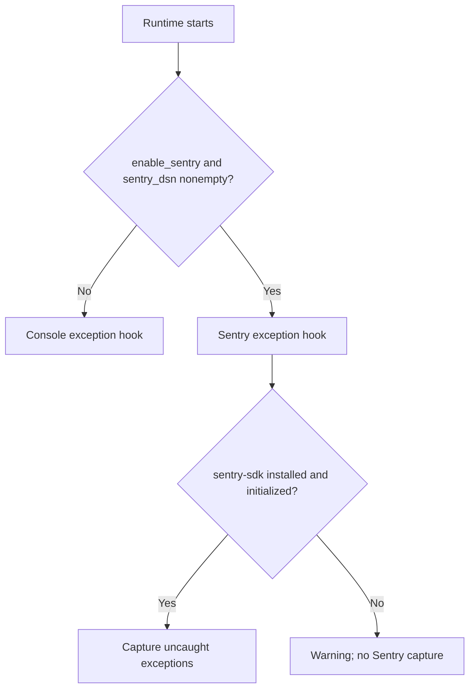

Velto CLI does not have a `telemetry` command. **Qyro Engine** chooses an exception-reporting adapter when `VeltoContext` initializes. CLI build failures and runtime exceptions belong to different diagnostic systems.

## What Engine actually reads

`EngineContainer` loads merged runtime settings and reads only these telemetry-related keys directly:

| Source | Key or control | Effect |
| --- | --- | --- |
| `base.json`, platform override, or runtime secrets | `sentry_dsn` | A nonempty value selects the Sentry exception hook when enabled |
| Runtime settings | `version` | Used as Sentry's release identifier (fallback `0.1.0` in container) |
| `VeltoContext` constructor | `enable_sentry=True` | Allows Sentry selection; `False` forces console hook |
| Project Python environment | `sentry-sdk` | Must be installed for Sentry initialization; optional `velto init --addon sentry-sdk` can add it to a generated project |

Example *configuration fragment*, not a replacement project:

```json
{
  "version": "1.0.0",
  "sentry_dsn": "https://examplePublicKey@o0.ingest.sentry.io/0"
}
```

The DSN above is an illustrative placeholder. Decide carefully whether you want DSNs exposed in project settings; use deployment-time configuration appropriate to your threat model.

## Decision process



The console hook replaces `sys.excepthook` and prints unhandled exceptions to stderr. The Sentry hook initializes `sentry_sdk` with the configured DSN and release, an **internal** `environment="production"` default, and a hardcoded `traces_sample_rate=0.2`. Those last two values are **not currently documented JSON settings**. A configured `SENTRY_DSN` environment variable is supported by the Sentry adapter itself, but **does not activate that adapter in `EngineContainer` without a truthy `sentry_dsn` setting**. In other words, setting `SENTRY_DSN` alone is not sufficient for the standard `VeltoContext` startup path.

<Warning>Do not invent a nested `telemetry` JSON object or `telemetry.enabled` setting. The `qyro/release` implementation shown here uses the flat `sentry_dsn` key. Installing `sentry-sdk` alone does not enable reporting.</Warning>

## Production considerations

Sentry reports can contain stack traces or application data. Review collection, scrubbing, consent, network failure behavior, and retention before production use. Sentry reporting does not explain why `velto build`, `bundle`, or `sign` failed; use the CLI logs and [Troubleshooting](/cli/troubleshooting) for that.

**Verified implementation:** `Neuri-AI/qyro` branch `release`, `qyro/container.py`, `qyro/adapters/telemetry/sentry_hook.py`, and `qyro/adapters/telemetry/console_hook.py`.
