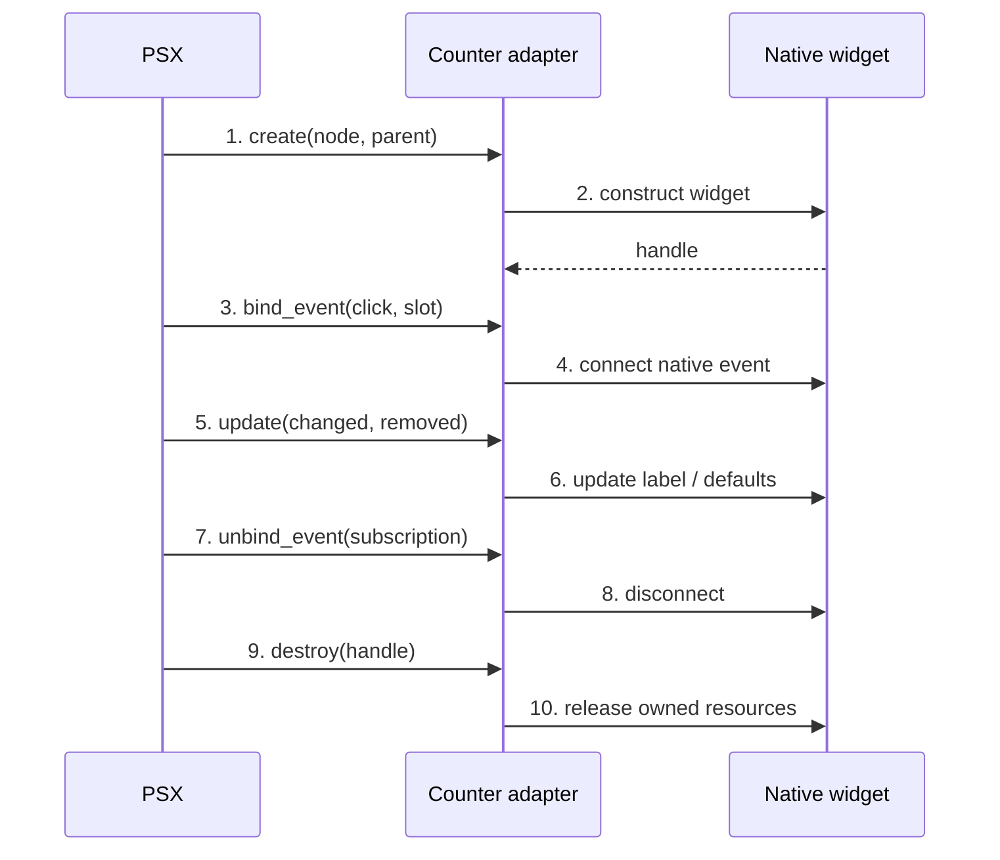

## What is an adapter?

A renderer knows which toolkit it is using. An **adapter** is the helper responsible for *one kind of node*. Think of it as the person who translates "show 7" into Qt's `setText("7")`, Tkinter's `configure(text="7")`, or Kivy's `label.text = "7"`.

## The contract documented by PSX

```python
class CounterAdapter:
    def create(self, renderer, node, parent):
        ...

    def update(self, renderer, handle, changed, removed):
        ...

    def bind_event(self, renderer, handle, event, slot):
        ...

    def unbind_event(self, renderer, subscription):
        ...

    def destroy(self, renderer, handle):
        ...
```

This is a **contract illustration, not runnable adapter code**. `handle`, `parent`, subscription types and node shape must be taken from the concrete renderer implementation.



## What must be checked in each backend

| Contract step | Qt | Tkinter | Kivy |
| --- | --- | --- | --- |
| `create` | Parent `QWidget` | Tk master | Kivy parent |
| `update` | `setText`, properties | `configure` | property assignment |
| `bind_event` | signal connection | `command`/bind | `bind` |
| `unbind_event` | disconnect signal | unbind/replace callback | `unbind` |
| `destroy` | ownership-aware cleanup | `destroy` | remove widget / cleanup |

Do not assume a generic `destroy()` implementation is safe across backends. A borrowed widget must not be destroyed as if the framework owned it.

## Certification checklist

- [ ] Create one native widget from the actual renderer's handle contract.
- [ ] Change a property without recreating the widget.
- [ ] Remove a property and restore its documented default.
- [ ] Replace an event callback without duplicate subscriptions.
- [ ] Unmount and release resources once.
- [ ] Run the application through `velto start` for each backend.

## Why there is no fabricated drop-in adapter here

The supplied documents specify the adapter method signatures but **do not include the concrete renderer handle and node internals**. A fully executable Qt/Tkinter/Kivy adapter requires reading those implementations on `develop`. See [Build a renderer adapter](/extensibility/build-a-renderer-adapter) for the source-verification gate. This is an explicit unfinished certification task, not a hidden prerequisite for the reader.
