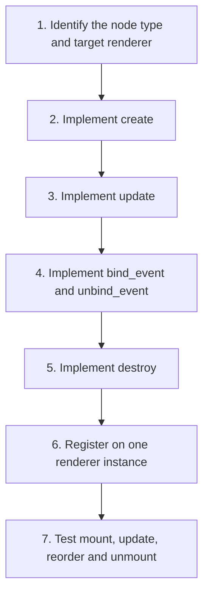

This guide teaches **how to build and test an adapter without pretending an incomplete skeleton is runnable**. An adapter is backend-specific infrastructure. You need a real renderer instance and its handle types before writing a complete implementation.

## Goal

Suppose you want a custom `acme.Counter` node in a PySide6 renderer. A component registry can resolve the name, but it cannot create the Qt control. An adapter must implement the native lifecycle.

## Numbered implementation plan



## The methods to implement

```python
# Contract-oriented skeleton, NOT a drop-in runnable adapter.
class CounterAdapter:
    def create(self, renderer, node, parent):
        raise NotImplementedError("Create the backend widget and return its handle")

    def update(self, renderer, handle, changed, removed):
        raise NotImplementedError("Apply changed and removed properties")

    def bind_event(self, renderer, handle, event, slot):
        raise NotImplementedError("Connect the event and return a subscription")

    def unbind_event(self, renderer, subscription):
        raise NotImplementedError("Disconnect the subscription")

    def destroy(self, renderer, handle):
        raise NotImplementedError("Release the native widget")
```

The signatures are based on the reviewed `ComponentAdapter` protocol. The **handle representation, native parenting and event subscription type** must come from the actual renderer implementation. A made-up Qt handle would be misleading.

## Register and inspect

```python
from psx import register_adapter, renderer_capabilities

# Only after creating a real renderer and implementing the adapter:
# register_adapter(renderer, "acme.Counter", CounterAdapter())
# assert "acme.Counter" in renderer_capabilities(renderer).components
```

## Acceptance tests

| Test | What it proves |
| --- | --- |
| Mount once | `create` produces one native control |
| Change a property | `update` changes it without recreating the widget |
| Remove a property | `removed` restores the documented default |
| Replace event callback | Old event subscription is disconnected |
| Unmount | `destroy` frees the handle once |
| Reorder keyed siblings | Identity and child operations stay consistent |

## Source verification needed

To publish a fully runnable PySide6 adapter, inspect the renderer's actual adapter registry, node type, native handle conventions, parenting and event subscription implementations on `develop`, then replace this educational skeleton with a tested end-to-end example. The attached pages do not contain enough source code to do that responsibly.

Continue to [Compatibility and troubleshooting](/extensibility/compatibility-and-troubleshooting).
