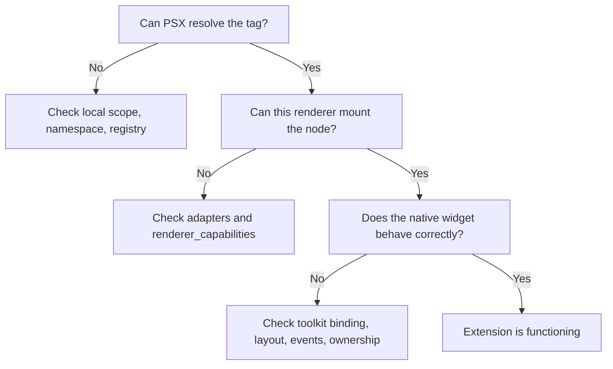

When an extension fails, first ask **which stage failed?** Most problems belong to one of three boundaries: name resolution, renderer capability, or native toolkit integration.

## Diagnose in order

## Symptom lookup

| Symptom | Likely cause | First check |
| --- | --- | --- |
| Unknown custom tag | Missing scope or registry | `registry=` / namespace / local names |
| Duplicate component | Registered twice | Registry's existing definitions |
| Plugin installed but missing | Not loaded or discovered | `load_plugins(..., discover=True)` if intended |
| Plugin loaded but tag missing | Wrong registry | Registry passed to compilation |
| `RendererCapabilityError` | Missing adapter | `renderer_capabilities(renderer)` |
| Qt widget used with Kivy | Toolkit mismatch | Choose a compatible widget/renderer |
| Double event firing | Old listener not removed | `unbind_event` and cleanup |
| Crash or leak on close | Wrong ownership or destroy logic | Owned vs borrowed widget lifecycle |
| Blank native control | Sizing/geometry mismatch | Parent and layout measurement |

## Frequently asked questions

**Does every plugin become a tag?** No. Only components made resolvable by the active markup path can appear as tags. A plugin may register adapters or other capabilities instead.

**Does publishing to PyPI activate a plugin?** No. Packaging, loading and registration are distinct.

**Does `<Native>` work with every toolkit widget?** No. It requires compatible renderer support; borrowed Tkinter instances are unsupported in the reviewed contract.

**Can I use the same component across renderers?** Often, if it composes standard nodes. A Qt-specific widget remains Qt-specific.

**Is Cinnamon another extension layer?** No. Cinnamon is integrated within PSX as its layout engine.

**Is PSX Markup inherently declarative?** The project's terminology is **PSX Markup**. Do not use “declarative” as its defining label.

## Next steps

If resolution fails, see [Component registration](/extensibility/component-registration). If plugin loading fails, see [Plugins and discovery](/extensibility/plugins-and-discovery). For native lifecycle bugs, see [Renderer adapters](/extensibility/renderer-adapters).
