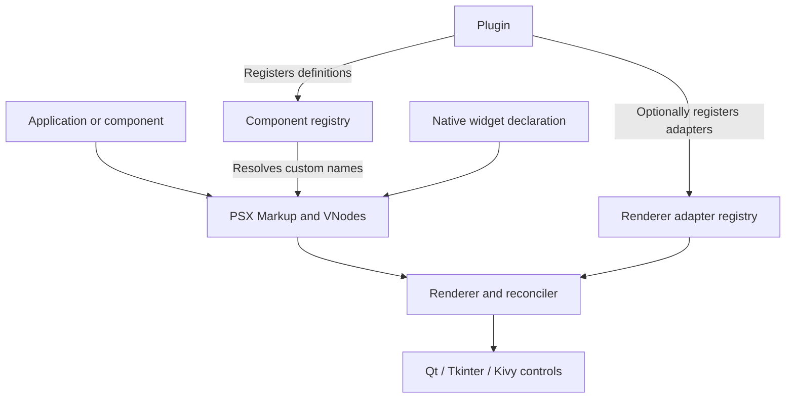

Extending Velto means adding capabilities **without changing the framework's source code**. There is more than one way to do that. Choosing the smallest appropriate mechanism makes your code easier to reuse, test, and maintain.

This section assumes you already understand [PSX Markup](/markup/overview), components, and the idea of a renderer. You do **not** need to know how a renderer is implemented.

## Start with a problem, not an API

Imagine a desktop application that displays monitoring dashboards. You want to:

- Reuse the same status panel across several screens.
- Distribute the panel to other teams as a Python package.
- Support a custom visual control that the selected renderer cannot create yet.
- Embed an existing Qt plotting widget rather than rebuilding a charting engine.

These are different problems. They should not all become plugins or custom renderers.

| Your problem | Start with | Why |
| --- | --- | --- |
| Reuse PSX UI and behavior | [Component libraries](/extensibility/component-libraries) | Compose existing components; no renderer work needed |
| Register capabilities from a separately distributed package | [Plugins and discovery](/extensibility/plugins-and-discovery) | Explicit installation and registration lifecycle |
| Teach a particular renderer how to handle a component | [Renderer adapters](/extensibility/renderer-adapters) | Toolkit-specific creation, updates, events, cleanup |
| Embed a widget supplied by Qt, Tkinter, or Kivy | [Native widget integration](/extensibility/native-widget-integration) | Reuse an existing native implementation |

**Rule of thumb:** if existing PSX components can express your UI, prefer composition. A plugin is a packaging and registration mechanism, not a requirement for reusability. An adapter is lower-level infrastructure, not a substitute for a component.

## Four concepts that sound similar

A **component** describes *what* should appear. A **component registry** maps a name (such as `acme.Status`) to the Python constructor that produces a PSX node. A **renderer adapter** describes *how one renderer* creates and maintains a corresponding native control. A **plugin** is a Python object with `register(api)` that can register components and adapters together.

This diagram shows **responsibilities**, not an automatic global initialization sequence. Registries are scoped objects. A component registered in one registry is not automatically available in another.

## What registration does—and does not do

Two questions must be answered independently:

1. **Can PSX resolve the component name?** A `ComponentRegistry` holds constructors; the template compiler accepts `registry=` for explicit resolution.
2. **Can this renderer handle the resulting node?** The renderer's adapter registry and supported node types determine that.

Registering a component name does not install a GUI dependency, make an arbitrary toolkit widget portable, or guarantee that every renderer can mount it.

Likewise, installing a Python package with plugin metadata does **not** activate discovery. `load_plugins(..., discover=True)` explicitly opts in.

## Scope and portability

A library that composes `Text`, `Flex`, and `Button` can often work across supported renderers. A library wrapping `QWebEngineView` needs a compatible Qt binding and renderer. Portable **component definitions** and portable **native behavior** are different promises.

Renderer capabilities are checked against a **concrete renderer instance**, not against a marketing list of supported platforms. See [Renderer adapters](/extensibility/renderer-adapters).

## Ownership and lifecycle matter

Native controls occupy real resources: windows, event subscriptions, parent relationships, and sometimes GPU memory. Velto must know whether it created a control or temporarily borrowed one. That choice determines what happens when the PSX node disappears. See [Native widget integration](/extensibility/native-widget-integration).

## How to read this section

Read [Component libraries](/extensibility/component-libraries) for the smallest reusable extension. Continue with [Plugins and discovery](/extensibility/plugins-and-discovery) when distributing registration logic. Read [Renderer adapters](/extensibility/renderer-adapters) only when native lifecycle behavior must change. Use [Native widget integration](/extensibility/native-widget-integration) when a suitable toolkit control already exists.

<Note>
The public extension primitives are implemented in the PSX codebase. Examples that use the root `psx` imports demonstrate the underlying public PSX extension surface verified on the `develop` branch; they are **not** a claim that every symbol is re-exported by `velto.ui`. Your application's canonical Velto imports remain those taught in Getting Started.
</Note>
