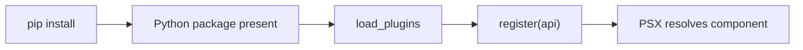

## First: what problem does a plugin solve?

Suppose you have several components and adapters. Without a plugin, each application would have to register them manually. A plugin groups those registrations behind **one method**: `register(api)`.

## Step 1 — the component

```python
from psx import Text

def StatusLabel(*, label: str):
    return Text(label)
```

This component produces an existing built-in `Text` node. It therefore needs **no custom native adapter**.

## Step 2 — the plugin

```python
class StatusPlugin:
    def register(self, api):
        api.component("StatusLabel", StatusLabel)
```

`api` is the `PluginAPI` passed to the plugin loader. Its `.component(...)` method registers a component definition. A plugin is **not** itself a PSX tag.

## Step 3 — an isolated registration check

```python
from psx import builtin_component_registry, load_plugins, psx

registry = builtin_component_registry()
loaded = load_plugins(registry, plugins=[StatusPlugin()], namespace="acme")
assert len(loaded) == 1
node = psx('<acme.StatusLabel label="Online" />', registry=registry)
print(node)
```

This is a **non-GUI registration check**, not an application launch. GUI acceptance tests use `velto start`. The `registry=` entry point shown here is supported by the attached PSX documentation; whether the same registry is threaded through your VeltoContext render path must be verified in the source.

## Step 4 — where an adapter fits

`PluginAPI` can also register adapters for **named renderer instances**, according to the documented extension surface. The adapter must already be implemented for the renderer's concrete node/handle contract. Do not confuse `api.component(...)` with installing a native widget.

## Step 5 — installation is not activation



`discover=True` opts into Python entry-point discovery; installation alone does not activate it. See [Plugins and discovery](/extensibility/plugins-and-discovery) and [Publishing](/extensibility/publishing-your-extension).

## Check yourself

1. Does `StatusPlugin` become `<StatusPlugin />`? **No.** It registers `StatusLabel`.
2. Does registering `StatusLabel` create a new native control? **No.** It returns built-in `Text`.
3. Can another registry resolve `acme.StatusLabel` automatically? **No.** Registries are scoped.
