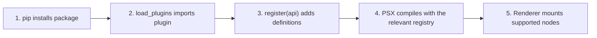

Installing a plugin package is like putting a book on a shelf. **Loading** opens the book; **registration** makes its capabilities available to the application. Those are different operations.

## Three steps, not one



**Installing does not activate discovery.** The documented `load_plugins` default is `discover=False`. The application must explicitly pass plugins or opt into discovery.

## What can a plugin register?

| API | Responsibility |
| --- | --- |
| `api.component(name, constructor, contract=None)` | Add a named component |
| `api.adapter(renderer, component, adapter, replace=False)` | Register an adapter on a **named renderer instance** |
| `api.capabilities(renderer)` | Inspect that renderer's capabilities |

A plugin may register components and adapters together, but does not have to. A plugin that provides a nonvisual capability will not automatically create a markup tag.

## Discover installed plugins

The documented Python entry-point group is **`psx.plugins`**, even though the framework is called Velto:

```toml
[project.entry-points."psx.plugins"]
status = "acme_status:StatusPlugin"
```

This means: advertise a plugin named `status` whose exported class lives at `acme_status.StatusPlugin`. The package must really contain that module and class.

```python
from psx import builtin_component_registry, load_plugins

registry = builtin_component_registry()
loaded = load_plugins(registry, discover=True)
```

`discover=True` scans the configured Python entry-point metadata **when called**; it is not a permanent background scanner. This example demonstrates discovery, not guaranteed availability of any particular third-party package.

## What does `renderers={...}` mean?

The key in `api.adapter("desktop", ...)` refers to the mapping passed to `load_plugins`, such as `renderers={"desktop": renderer_instance}`. It is **not** a magic renderer name or an automatic search. Unknown keys raise `KeyError`.

## Safety and conflicts

A discovered plugin runs Python code in your process. Install only trusted packages and pin dependencies where appropriate. Duplicate component registrations are rejected. Adapter replacement with `replace=True` is possible but can alter native lifecycle behavior; do not use it casually.

## If the plugin loaded but the UI did not change

Check the registry passed to markup, the component name and namespace, the renderer mapping, and native backend compatibility. Continue to [Compatibility and troubleshooting](/extensibility/compatibility-and-troubleshooting).
