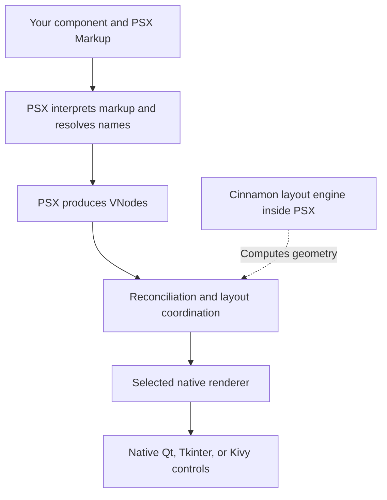

You already know how to write an interface with PSX Markup. You can place a `<Text>` inside a `<Flex>`, respond to a button click, and use hooks to update what appears on screen.

But when you write `<Text>Hello</Text>`, **what actually creates the text you see in a native desktop window?**

The markup itself does not create a Qt, Tkinter, or Kivy widget. It describes the interface you want. PSX and the selected renderer work together to turn that description into visible controls.

Understanding this distinction will help you see why ordinary components are easy to reuse—and why integrating an entirely new kind of native control sometimes requires an adapter.

## Your markup is not a widget

Consider this familiar example:

```python
from velto.ui import psx

view = psx("""
    <Flex direction="column" gap="12">
        <Text>Hello, Velto!</Text>
        <Button>Continue</Button>
    </Flex>
""")
```

The result of `psx()` is a **VNode**: a Python representation of the interface, not a visible window. A VNode records what an element is, which properties it has, and which elements belong inside it.

In this example, the `Flex` node contains a `Text` node and a `Button` node. No native button or label has been created merely by assigning this result to `view`.

You can think of a VNode as a plan for the interface. A plan describes what should exist; a renderer is responsible for making it appear on screen.

## How PSX understands your markup

Before PSX can produce that plan, it needs to understand the markup string. It reads the tags and attributes, evaluates supported expressions, and determines what each tag refers to.

For example, PSX already knows the built-in `Text` and `Flex` elements. If you write a custom tag such as `<CounterCard />`, PSX must also be able to resolve that name to the component you defined.

Once the names and expressions have been resolved, PSX constructs the corresponding VNodes. A component created with `@component` can itself produce more PSX nodes when its render function runs.

The distinction matters: **a custom component is not automatically a new native widget**. It can simply produce a combination of existing elements that the renderer already understands.

## From VNodes to native controls

The application uses a renderer for its selected backend. For a PySide6 application, that means a Qt-based renderer; other backends have their own implementations.

The renderer takes the interface described by PSX and manages the native controls needed to display it. Layout also matters: elements need positions and sizes, not just names and properties. **Cinnamon, Velto's layout engine integrated into PSX**, participates in determining that geometry.

The following diagram is a conceptual overview, not a strict call-by-call execution trace. Rendering, layout, and updates can interact and repeat as the application changes.



For a familiar built-in element such as `Text`, the selected renderer already has the necessary support. You do not need to write a native control yourself.

## What happens when state changes

Now consider a counter you have already seen in earlier lessons:

```python
from velto.ui import component, psx, use_state


@component
def CounterCard():
    count, set_count = use_state(0)

    def increment():
        set_count(count + 1)

    return psx("""
        <Flex direction="column" gap="12">
            <Text>Counter: {count}</Text>
            <Button on_click={increment}>Add one</Button>
        </Flex>
    """)
```

When the button is clicked, `set_count` requests an update. PSX can produce the next description of the component's interface, now containing the new counter value.

**Reconciliation** is the process of comparing the desired interface with what was previously rendered. It helps determine which parts can be preserved and which need updating.

For this counter, the important visible change is the text. The intended result is an updated label, not a complete replacement of the entire application window. The renderer applies the necessary changes to the native interface, while layout can be recalculated when required.

This is why a VNode is useful: PSX can reason about the interface before asking the native toolkit to change anything.

## Where extensions fit

Return to the `CounterCard` example. It uses `Flex`, `Text`, and `Button`, all of which are existing PSX elements. Your component combines them in a new way, so **no custom renderer adapter is needed**.

But suppose you want to add a specialized control that the selected renderer does not already know how to handle. Perhaps it is a custom native editor, a specialized visualization, or another toolkit-specific widget.

Now a new question appears: **how should this renderer create, update, and clean up that control?**

That is the kind of problem a renderer adapter can address. An adapter connects a supported node or control type to the operations required by a particular renderer. It is different from resolving a component name in PSX Markup: recognizing `<MyControl />` does not, by itself, teach Qt or another toolkit how to display an unfamiliar native control.

Not every native integration requires writing an adapter from scratch. Velto also supports integrating compatible existing widgets through its native-widget facilities, which you'll explore later.

For now, remember the boundary: **component composition reuses controls Velto already supports; native extensions deal with controls that require additional toolkit integration**.

In the next guide, [Native controls by backend](/extensibility/native-controls-by-backend), you'll explore what native controls the different renderers can display and why backend compatibility matters when extending Velto.
