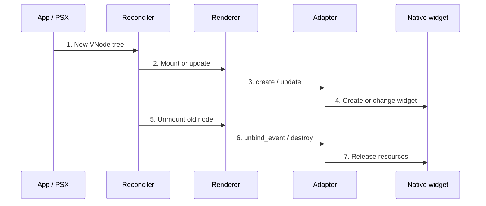

An adapter is a translator between **a PSX node** and **a particular native toolkit**. Most Velto applications never need a custom adapter: start with components or `Native` first.

## What happens when a button changes?



PSX decides **what changed**. The adapter knows **which toolkit methods to call**. The adapter does not replace reconciliation, keys, hooks or Cinnamon layout.

## The documented `ComponentAdapter` contract

| Method | Purpose |
| --- | --- |
| `create(renderer, node, parent)` | Make the native control |
| `update(renderer, handle, changed, removed)` | Apply changed properties; clear removed ones |
| `bind_event(renderer, handle, event, slot)` | Attach event and return a subscription handle |
| `unbind_event(renderer, subscription)` | Detach the previous subscription |
| `destroy(renderer, handle)` | Release native resources |

Optional `insert`, `move` and `remove` child hooks can return `True` when handled; otherwise the renderer handles the operation.

## Register on a specific renderer instance

```python
from psx import register_adapter, renderer_capabilities

# renderer: an existing compatible renderer instance
# custom_adapter: a complete ComponentAdapter implementation
register_adapter(renderer, "acme.Chart", custom_adapter)
capabilities = renderer_capabilities(renderer)
assert "acme.Chart" in capabilities.components
```

This is an **API contract fragment**, not standalone code: `renderer` and `custom_adapter` are intentionally supplied by the integration. Registration on one renderer does not register the adapter on every renderer.

## A capability is not a portability guarantee

`renderer_capabilities(renderer)` reports `name`, `components` and `supports_native` for that **concrete instance**. `supports_native` does not mean every native widget class is supported.

## When an adapter is too much

If you can create the same UI with `<Text>` and `<Flex>`, compose components. If Qt already supplies the widget, try `<Native>` first. Write an adapter only when you need custom native creation, updates, event handling or cleanup.
