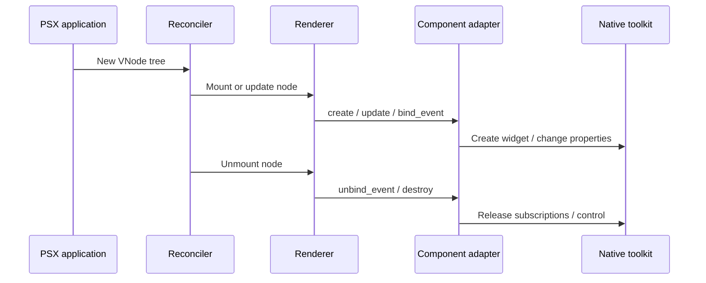

A **renderer** connects PSX's UI description to a concrete toolkit such as Qt, Tkinter, or Kivy. A **component adapter** is the part that handles one kind of component for **one renderer instance**.

Most application developers never need to write an adapter. Start here only when ordinary PSX composition or [`Native`](/extensibility/native-widget-integration) cannot provide the behavior you need.

## Why adapters exist

PSX reconciles the old and new UI trees. It can decide that a `Button` changed its label without recreating the entire screen. But PSX's abstract tree cannot itself call Qt's `setText()` or connect a Kivy event. The renderer delegates those native operations to an adapter.



The reconciler still manages node identity, keys, hooks, refs, and cleanup ordering. An adapter does **not** replace reconciliation or the layout engine.

## The adapter lifecycle contract

The verified `ComponentAdapter` protocol defines:

| Method | When it matters |
| --- | --- |
| `create(renderer, node, parent)` | Create a native handle for a mounted VNode |
| `update(renderer, handle, changed, removed)` | Apply changed properties and clear removed ones |
| `bind_event(renderer, handle, event, slot)` | Attach a callback and return a subscription handle |
| `unbind_event(renderer, subscription)` | Remove the previous subscription safely |
| `destroy(renderer, handle)` | Release the native handle on unmount |

The optional `insert`, `move`, and `remove` child hooks may return `True` if the adapter handled an operation. Returning `False`, or omitting the hook, leaves it to the renderer. These optional hooks must not be assumed to exist on every adapter.

## Registration is instance-scoped

A renderer exposes `register_adapter(component, adapter, replace=False)` and an `adapters` registry. For example, the underlying public helper can register an adapter on a renderer object:

```python
from psx import register_adapter, renderer_capabilities

# `renderer` is an already-created, compatible renderer instance.
# `custom_adapter` implements the ComponentAdapter lifecycle protocol.
register_adapter(renderer, "acme.Chart", custom_adapter)
capabilities = renderer_capabilities(renderer)
assert "acme.Chart" in capabilities.components
```

This snippet shows the registration contract, **not** a complete adapter implementation. Writing a working adapter requires backend-specific widget construction, updates, event subscriptions, and cleanup. The capability check confirms a registered key, not that a particular native feature will work on every operating system.

<Note>
The code above is intentionally a contract fragment: `renderer` and `custom_adapter` are supplied by your integration. It is not a copy-paste standalone application. For most third-party Qt widgets, prefer `Native` before implementing a complete adapter.
</Note>

## How capability inspection works

`renderer_capabilities(renderer)` returns a `RendererCapabilities` value with `name`, `components`, and `supports_native`. It reads the adapter registry on that **specific object**. `supports_native` means the `Native` adapter key is present; it does not guarantee support for every toolkit class or ownership mode.

## Replacing an adapter is a high-impact change

By default, registering a second adapter for the same component raises an error. Passing `replace=True` overrides that mapping for the renderer instance. This can change how existing UI elements are created, updated, or destroyed. A replacement must preserve the expected lifecycle and should be tested against mounting, updates, event rebinding, and unmounting.

## Common failure patterns

| Symptom | What to inspect |
| --- | --- |
| `RendererCapabilityError` | Missing adapter for the component key |
| Duplicate adapter error | Registration already exists; investigate before using `replace=True` |
| Event fires twice after updates | Old subscription not removed in `unbind_event` |
| Widgets leak or crash on close | `destroy` or ownership handling is incorrect |
| Layout is wrong | Renderer/layout responsibilities, not just adapter properties |

The key distinction is **name resolution versus native implementation**: [Component libraries](/extensibility/component-libraries) covers the first; this page covers the second.
