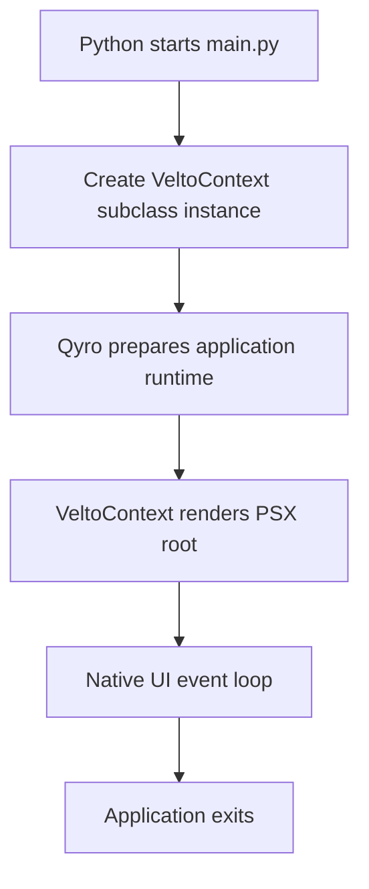

A Velto application has a **native event loop** and a **PSX component tree**. `VeltoContext` connects these concerns through the Qyro runtime.

## Application lifecycle



The diagram shows the conceptual lifecycle. It is not a promise that every renderer performs each internal step in exactly this order.

## Run a native Velto application

```python main.py
import sys

from velto import VeltoContext
from velto.ui import psx
from velto.runtime import is_frozen


class MyApp(VeltoContext):
    def render(self):
        execution = "Frozen executable" if is_frozen() else "Source code"
        return psx("""
            <Flex direction="column" padding="16px" gap="12px">
                <Text font_size="22">Runtime status</Text>
                <Text>{execution}</Text>
            </Flex>
        """)


if __name__ == "__main__":
    sys.exit(MyApp().run())
```

The `run()` method is the entry point to the native event loop. Do not start a second event loop inside `render()`.

## Supported toolkit families

Velto's documented runtime targets the following Python GUI bindings, subject to the corresponding optional dependencies and compatibility constraints:

| Family | Bindings |
| --- | --- |
| Qt | PySide6, PyQt6, PyQt5, PySide2 |
| Kivy | Kivy |
| Tk | Tkinter |

PSX Markup is the public UI authoring layer. Native widgets remain toolkit-specific: a Qt widget is not automatically compatible with Kivy or Tkinter.

## Platform and execution information

The runtime publicly exports `PlatformType`, `ExecutionMode`, `PlatformDetector`, and `AppMetadata` through `velto.runtime`.

```python
from velto.runtime import PlatformType, ExecutionMode, is_frozen

print("Frozen:", is_frozen())
print("Platform enum:", PlatformType)
print("Execution-mode enum:", ExecutionMode)
```

These enums and helpers describe the runtime environment. For an ordinary application, `is_frozen()` is usually sufficient to distinguish source and frozen execution.

## Keep rendering responsive

Avoid blocking network requests or heavy computation directly in `render()` or in a button callback running on the UI thread. Use a toolkit-compatible worker strategy for long-running tasks, then safely update application state.

## Troubleshooting

If startup fails, verify the GUI binding installed in your environment and the framework selected by your project's generated settings. `FrameworkNotAvailableError` is part of the public runtime error surface.
