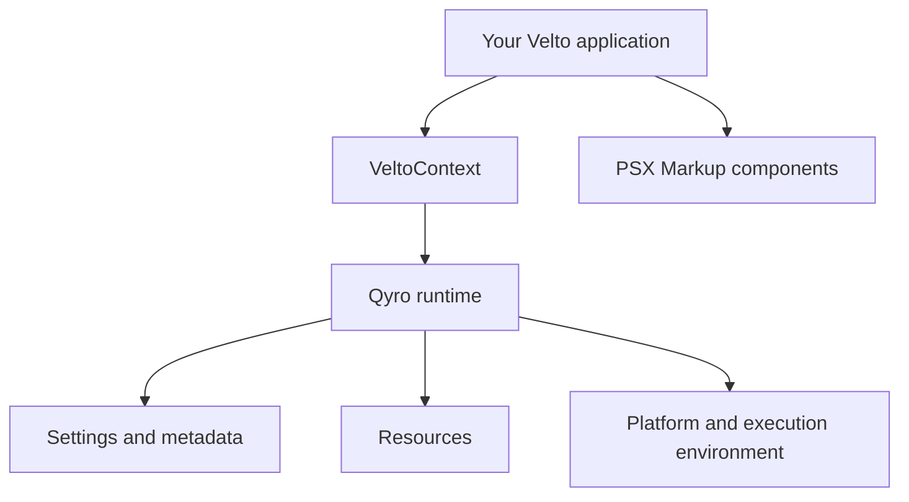

Velto combines **PSX Markup** for the interface with **Qyro** for application runtime services. You usually interact with Qyro through `VeltoContext` and the `velto.runtime` namespace rather than importing Qyro directly.

## Where the runtime fits



`VeltoContext` starts and coordinates the application; `render()` describes what should appear on screen. Runtime helpers are for concerns outside the component tree, such as locating an image or reading build settings.

## Your first runtime-aware application

```python main.py
import sys

from velto import VeltoContext
from velto.ui import psx
from velto.runtime import is_frozen


class MyApp(VeltoContext):
    def render(self):
        mode = "Packaged executable" if is_frozen() else "Python source"
        return psx("""
            <Flex direction="column" gap="12px" padding="16px">
                <Text font_size="22">Velto runtime</Text>
                <Text>Execution: {mode}</Text>
            </Flex>
        """)


if __name__ == "__main__":
    sys.exit(MyApp().run())
```

The interface is built with PSX Markup, while the runtime helper answers whether the application is running from a frozen executable.

## Public entry points

| Import | Purpose |
| --- | --- |
| `from velto import VeltoContext` | Application entry point and runtime lifecycle |
| `from velto.runtime import get_resource` | Resolve packaged or source resources |
| `from velto.runtime import is_frozen` | Detect frozen execution |
| `from velto.runtime import load_build_settings` | Read build settings |
| `from velto.runtime import PlatformType, ExecutionMode` | Runtime type definitions |

For a deeper walkthrough, continue with [VeltoContext](/runtime/velto-context), [Settings and configuration](/runtime/settings-and-configuration), and [Resources and environment](/runtime/resources-and-environment).
